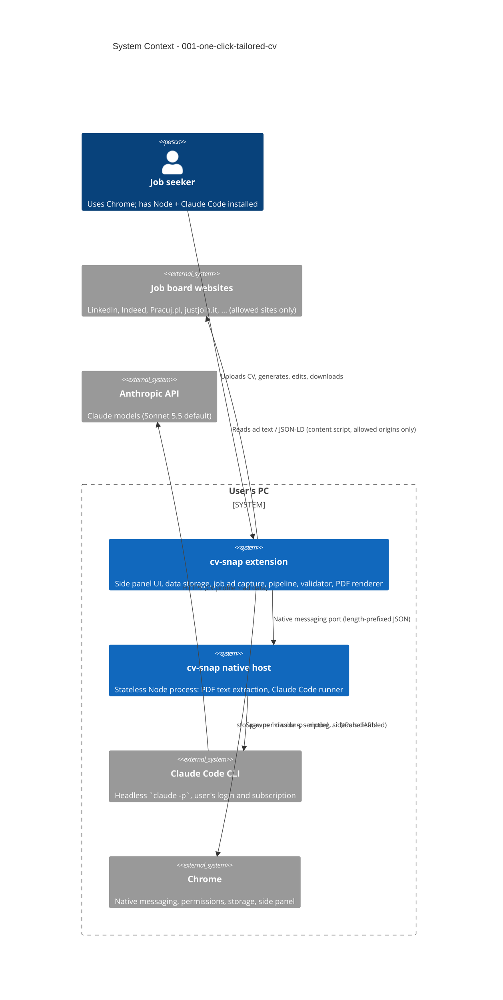

# One-Click Tailored CV - System Context

## System Overview

cv-snap is a local-only system made of two processes on the user's Windows PC:

- **cv-snap extension** (Chrome MV3, WXT + React): side panel UI, all persistent data, job ad capture on user-allowed sites, generation pipeline orchestration, deterministic validation, PDF rendering.
- **cv-snap native host** (Node.js): stateless bridge started by Chrome via native messaging; extracts PDF text and runs headless Claude Code for every AI step.

There is no cv-snap server. The only data leaving the PC goes to Anthropic, through the user's own Claude Code.

## Actors

- **Job seeker** (Human): installs the host, uploads and reviews the CV profile, allows sites, clicks Generate, reviews/edits the preview, downloads the PDF.
- **Job board page** (External content, untrusted): provides the job ad text and possibly `JobPosting` JSON-LD; may contain prompt-injection attempts.

## Context Diagram

## External Integrations

- **Claude Code CLI** (outbound from host, child process): headless `-p` mode with JSON output, `--model` selection, all tools disabled, empty temp working directory, capped turns, 120 s timeout. Minimum version = version tested during construction. **Risk: High** (core dependency; CLI flags may change between versions → spike first, health check warns on old versions).
- **Anthropic API** (indirect, via Claude Code): receives the CV profile, job ad text, and requirements. Governed by the user's Claude account terms. **Risk: Medium** (model availability per plan → `MODEL_UNAVAILABLE`).
- **Chrome platform APIs**: `nativeMessaging`, `storage`/`unlimitedStorage`, IndexedDB, `permissions` (optional host permissions), `scripting` (dynamic content scripts), `sidePanel`, `i18n`, `downloads`-style blob download. **Risk: Low**.
- **Job board websites** (inbound, untrusted): page DOM, readable text, `JobPosting` JSON-LD. **Risk: Medium** (layouts change; injection attempts).
- **Windows registry** (install-time only): HKCU native-messaging host key. **Risk: Low**.

## Data Flows

### Inbound (into cv-snap)
- **CV PDF** (binary, ≤ 10 MB) from the user → IndexedDB → host (base64 in a message, ≤ 64 MB limit) → extracted text.
- **Job ad** (HTML → readable text ≤ 50,000 chars, plus optional JSON-LD fields) from allowed pages, or a user selection (≥ 200 chars). Treated as untrusted data.
- **Claude output** (JSON) → zod schema validation → deterministic validator before use.
- **Photo** (JPG/PNG ≤ 2 MB) from the user → IndexedDB.
- **Profile import** (JSON with schema version) → schema validation.

### Outbound (out of cv-snap)
- **To Anthropic (via Claude Code)**: extracted CV text (profile creation), job ad text (requirements), profile + requirements (tailoring). Only during generation; disclosed in the first-run notice.
- **To the user's disk**: generated PDF download; profile export JSON.
- **Host → extension messages**: JSON only, < 1 MB (profile, requirements, plan, progress, errors). Never PDFs.

### Internal stores (extension only)
- `chrome.storage.local`: active profile, profile draft, settings (model, UI language, RODO clause + mode, privacy-notice acknowledgement version), allowed sites, requirements cache (per URL, 7-day TTL).
- IndexedDB: original PDF, photo, current-session generated CV.

## High-Level Constraints

- Windows 11 for the MVP; code portable to macOS/Linux.
- Local-only: no cv-snap server, no paid infrastructure.
- Claude Code is the only model access; the model is user-selectable (default Sonnet 5.5).
- Native messaging limits: host → extension < 1 MB per message.
- Site access only for user-granted origins; no default host permissions.

## Key NFR Goals

- Generation ≤ 60 s p95 (≤ 45 s with cached requirements); profile creation ≤ 90 s.
- 0 fabricated facts pass the validator on the regression set; ≥ 70% of CVs downloaded without edits.
- Prompt-injection cases in the regression set cause no behavior change.
- The host never crashes on malformed input; cancel ≤ 2 s.
