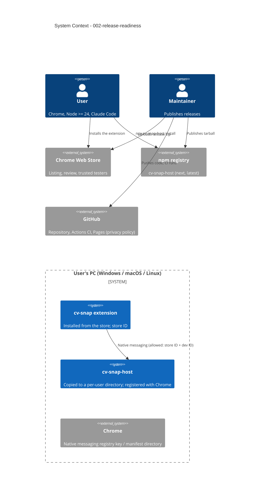

# Release Readiness - System Context

## System Overview

The product stays as intent 001 built it: the cv-snap extension and the stateless native host on
the user's PC, with no cv-snap server. This intent adds the **distribution channels** and the
**release tooling** around it:

- the extension reaches users through the **Chrome Web Store** (its own extension ID);
- the host reaches users through **npm** as `cv-snap-host`, installed with `npx` into a stable
  per-user directory and registered with Chrome on Windows, macOS or Linux;
- a **public GitHub repository** runs CI on three operating systems and serves the privacy policy
  through **GitHub Pages**.

## Actors

- **User** (Human): installs the extension from the store and the host with `npx`, runs `doctor`
  when something is wrong, reads the README and the privacy policy.
- **Maintainer** (Human): packs and publishes releases (Operations), owns the store and npm
  accounts.
- **Chrome Web Store reviewer** (External): checks the listing, permission justifications, data-use
  disclosures and the privacy policy.

## Context Diagram

## External Integrations

- **Chrome Web Store**: assigns the extension ID at item creation; reviews permissions and data use.
- **npm registry**: hosts `cv-snap-host`; dist-tags `next` (staging) and `latest` (production).
- **GitHub Actions**: Windows, macOS and Ubuntu runners for tests and install checks.
- **GitHub Pages**: static privacy policy page.

## Constraints

- Publishing and account setup are done by the user (Operations); this intent prepares artifacts.
- The installer makes no network requests and needs no admin rights.
- No telemetry is added; the privacy statements must match the product's behaviour.
