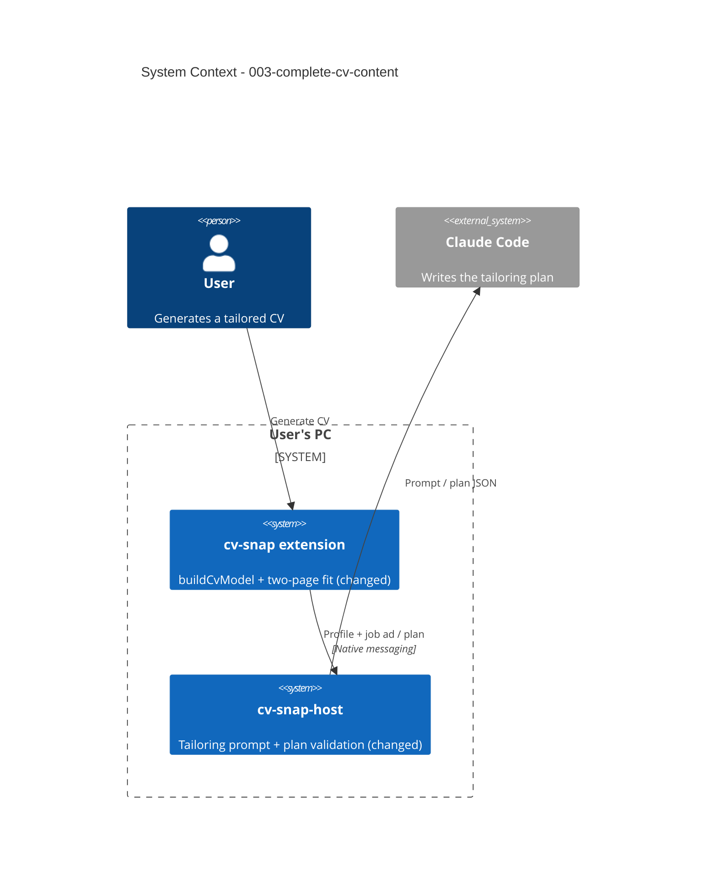

# Complete CV Content - System Context

## System Overview

No new parts and no new external systems. The fix stays inside the two existing pieces of intent
001 on the user's PC:

- the **extension** joins the tailoring plan to the profile (`buildCvModel`) and fits the CV to two
  pages (`fit-to-pages.ts`): this is where education, skills and other sections are printed or
  dropped;
- the **native host** builds the tailoring prompt and validates the plan (`shared/`): this is where
  the model learns it may select other sections, and where their IDs are checked.

## Actors

- **User** (Human): generates a tailored CV and expects all education, skills and relevant extra
  sections from the profile in it.
- **Claude Code** (External, via the host): writes the tailoring plan.

## Context Diagram

## Data Flows

### Inbound (to the extension)

- **Tailoring plan** from the host: gains an optional list of selected other-section IDs (FR-3).
  Older hosts omit it; the extension treats it as empty.

### Outbound

- **Tailored CV PDF**: now always contains every education entry and every skill (unless dropped
  to fit two pages and reported).

## Compatibility

| Extension | Host | Result |
|---|---|---|
| 0.1.1 | 0.1.1 | All fixes |
| 0.1.1 | 0.1.0 | Education and skills fixed; no other sections |
| 0.1.0 | 0.1.1 | As 0.1.0 (new plan field stripped by zod) |
