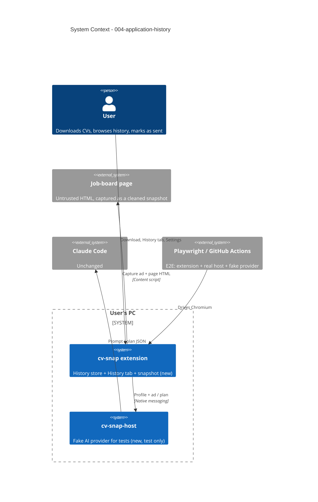

# Application History - System Context

## System Overview

No new external systems and no new Chrome permissions. History is a new feature of the
**extension**, stored on the user's PC. The **native host** changes only for testing: it gains a
fake AI provider that the end-to-end tests select through a test-only environment variable.

- **Extension**: captures a cleaned snapshot of the job-ad page with the ad, saves the downloaded
  PDF + ad + snapshot as a history entry, shows the History tab, applies retention, and includes
  history in the backup.
- **Native host**: unchanged for users; `CV_SNAP_FAKE_PROVIDER` (test only) swaps
  `ClaudeCodeProvider` for a provider returning canned JSON.
- **Playwright** (dev/CI only): drives Chromium with the unpacked dev build and the real host.

## Actors

- **User** (Human): downloads tailored CVs, browses history, marks applications as sent, sets
  retention, exports/imports backups.
- **Developer / CI** (System): runs the Playwright suite locally (Windows) and in GitHub Actions
  (Ubuntu).
- **Claude Code** (External, via the host): unchanged; not used by the E2E tests.

## External Systems

- **Job-board pages** (inbound, untrusted): their HTML is captured and cleaned into a snapshot.
  Images and styles of a snapshot still load from the original site when opened online.
- **GitHub Actions** (dev only): new E2E job.

## Context Diagram

## Data Flows

### Inbound (to the extension)

- **Page HTML** at capture time: cleaned in the extension (scripts, handlers, frames, `<base>`,
  form actions removed; URLs made absolute; CSP + banner added). Never sent to the host.
- **Backup file** on import: may contain history (metadata, PDFs, snapshots); validated with a
  schema and size limit before anything is written.

### Outbound

- **Backup file** on export: profile + history.
- Nothing new leaves the PC. The host still receives only the profile and the ad text.

### Stored (on this PC)

| Data | Where | Deleted when |
|---|---|---|
| History index (metadata, sent date) | IndexedDB `cv-snap` | Entry deleted, retention, uninstall |
| PDF bytes, cleaned snapshot | IndexedDB `cv-snap` | Same |
| Retention setting | `storage.local` (settings) | Uninstall |

## Compatibility

| Extension | Host | Result |
|---|---|---|
| 0.2.0 | 0.1.x | Works: history is extension-only; the fake provider isn't needed by users |
| 0.1.x | 0.2.0 | Works: protocol unchanged |
| 0.2.0 backup | 0.1.x import | Refused as a newer format (as today) |
| 0.1.x backup | 0.2.0 import | Profile imported; no history |
