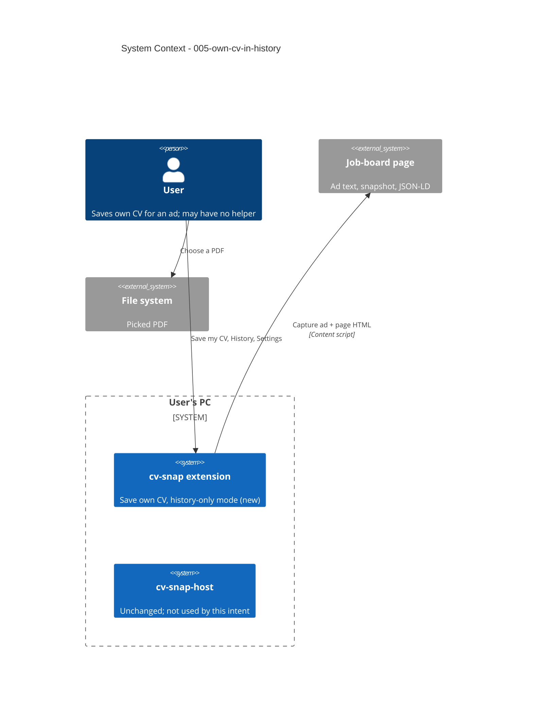

# Own CV in History - System Context

## System Overview

No new external systems, no new Chrome permissions, no host change. Everything is in the
**extension**: saving the user's own CV for a job ad, and a history-only mode that never talks to
the native host after the setup check.

- **Extension**: saves the stored original CV (or a picked PDF) with the captured ad and snapshot
  as a history entry marked "own"; offers history-only mode when the setup check fails; backups
  without a profile.
- **Native host**: unchanged. Not used by the save flow or in history-only mode.
- **Claude Code**: unchanged. Not used by this intent.

## Actors

- **User with the helper** (Human): saves their own CV for an ad next to tailoring.
- **User without the helper** (Human): uses cv-snap only to track applications with their own CV.
- **Developer / CI** (System): runs the new E2E test without a host registered.

## External Systems

- **Job-board pages** (inbound, untrusted): captured and cleaned as in intent 004; JSON-LD and the
  page title prefill the job title and company.
- **User's file system** (inbound): a PDF picked with Choose another PDF… or Replace….

## Context Diagram

## Data Flows

### Inbound

- **Picked PDF**: checked like a CV upload (PDF signature, not empty, at most 10 MB) before it is
  stored.
- **Page HTML and JSON-LD**: as in intent 004; title and company come from JSON-LD or the page title.

### Outbound

- **Backup file**: may now have no profile (history-only mode).
- Nothing goes to the host, Claude or the network.

## Data Stored (extension)

- History entry: optional `source: "own" | "tailored"` (absent = tailored); schema version stays 1.
- Panel mode: "history-only" flag in extension storage.
- Original CV (`cv-snap` / `files` / `cv-original`): now also written in history-only mode and by
  Replace….
